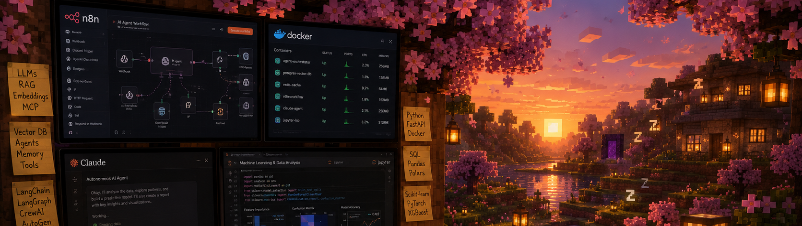

<p align="center">
  
</p>

<h2 align="center">Hi, I'm Mario</h2> 
<p align="center">
  <strong>Systems Engineering Student @UNMSM</strong><br/>
  AI Engineering · Data & Applied AI · Product Building
</p>

<p align="center">
  <a href="https://www.linkedin.com/in/mario-saldana-sanchez">LinkedIn</a> ·
  <a href="https://github.com/MBreadd">GitHub</a>
</p>

---

<h3 align="center">🎯 Focus & 🛠️ Tech Stack</h3>

<table align="center">
<tr>
<td width="50%" align="center" valign="top">

**AI Engineering**

LLMs · RAG · Agents · LoRA

**Data & Machine Learning**

Python · SQL · ML · Analytics

**Cloud & Automation**

Azure · APIs · Workflows

</td>
```html
<td width="50%" align="center" valign="top">

<h3>Technologies </h3>

<p>
  
  
  
  
  
  
  
</p>

</td>
```
</tr>
</table>

<h3 align="center">🚀 Featured Projects</h3>

<table align="center">
<tr>
<td width="50%" align="center" valign="top">

**[TenderAlert](https://github.com/MBreadd/TenderAlert)**

AI-powered procurement intelligence for Peruvian SMEs.

</td>
<td width="50%" align="center" valign="top">

**[BEEP](https://github.com/MBreadd/BEEP-EnGemma2)**

Multimodal AI for sound awareness and accessibility.

</td>
</tr>
<tr>
<td width="50%" align="center" valign="top">

**[IssuePilot](https://github.com/MBreadd/IssuePilot)**

AI agent for analyzing and managing GitHub issues.

</td>
<td width="50%" align="center" valign="top">

**[Ascua](https://github.com/MBreadd/Ascua)**

Offline-first PDF reader with reading goals and streaks.

</td>
</tr>
</table>

<h3 align="center">📊 GitHub Analytics</h3>

<p align="center">
  
  
</p>

<p align="center">
  
</p>

<p align="center">
  
</p>